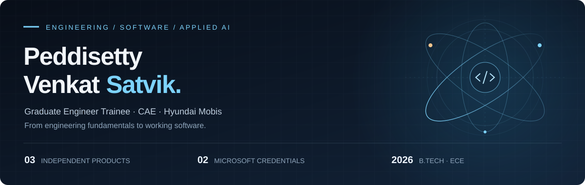
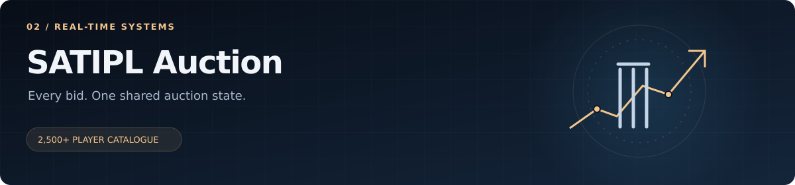
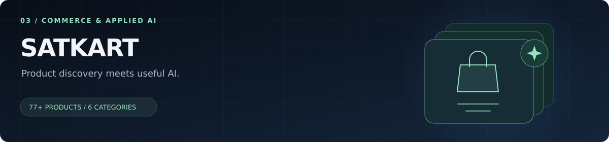

  <a href="https://satvik-portfolio20.vercel.app/"><strong>PORTFOLIO ↗</strong></a>
  &nbsp;&nbsp;&nbsp;·&nbsp;&nbsp;&nbsp;
  <a href="https://www.linkedin.com/in/peddisetty-venkat-satvik-363903284/"><strong>LINKEDIN ↗</strong></a>
  &nbsp;&nbsp;&nbsp;·&nbsp;&nbsp;&nbsp;
  <a href="mailto:satvikpeddisetty20@gmail.com"><strong>GET IN TOUCH ↗</strong></a>

  <a href="#about">About</a> &nbsp;/&nbsp;
  <a href="#selected-work">Selected work</a> &nbsp;/&nbsp;
  <a href="#research">Research</a> &nbsp;/&nbsp;
  <a href="#toolkit">Toolkit</a> &nbsp;/&nbsp;
  <a href="#credentials">Credentials</a>

 

## 01 / About

**Engineering by profession. Building software through independent work.**

I’m Satvik, a **Graduate Engineer Trainee in the CAE group at Mobis Technical Center of India**, Hyundai Mobis R&D in Hyderabad. I’m developing my automotive engineering skills through technical learning and collaboration with the team.

Alongside my role, I build products across **real-time communication, e-commerce, and applied AI**. I work across interfaces, backend services, databases, and deployment, with a particular interest in how these parts behave together.

| Professional focus | Independent work | Academic foundation |
| :--- | :--- | :--- |
| Graduate Engineer Trainee · CAE | Full-stack products · Real-time systems · Applied AI | B.Tech ECE · KL University · Class of 2026 |

My degree includes a specialization in **Artificial Intelligence and Intelligent Process Automation**.

 

## 02 / Selected work

Three independent products with distinct engineering challenges. Explore the applications or read the implementation highlights below.

### SatChat

A communication platform that brings **private chats, group messaging, stories, and file sharing** into one web and Android experience.

- **Live communication:** Socket.IO supports messaging between connected clients.
- **Storage and sessions:** Turso stores conversation and file data. Redis supports sessions, caching, and rate limits.
- **Android delivery:** Capacitor packages the web experience for mobile.

**Built with** &nbsp; `React` `Node.js` `Socket.IO` `Turso` `Redis` `Capacitor`

**[Explore SatChat ↗](https://satchat.pages.dev)** &nbsp;·&nbsp; [View Android listing ↗](https://store.indusappstore.com/app/app.satchat.messenger)

 

### SATIPL Auction

A cricket auction platform with **synchronized bidding, team budgets, and shared auction state** across connected clients.

- **Concurrent bids:** Bid locking serializes simultaneous bidding operations.
- **Consistent sales:** Atomic transactions keep player sales and team budgets together. Status checks guard against duplicate sales.
- **Client recovery:** Clients resynchronize when a tab regains focus.

**Built with** &nbsp; `React` `Express` `Socket.IO` `LibSQL`

**[Explore SATIPL Auction ↗](https://satiplauction.vercel.app)**

 

### SATKART

An e-commerce application combining **product discovery, order management, and a catalogue-aware AI assistant**.

- **Connected storefront:** A React interface communicates with an Express API and Turso database.
- **Product conversations:** A server-side NVIDIA model integration supports AI assistance with persistent chat history.
- **Administration:** A dashboard brings together product, order, and support management.

**Built with** &nbsp; `React` `Node.js` `Express` `Turso` `NVIDIA API`

**[Explore SATKART ↗](https://satkart.me)**

> **Interested in the implementation?** These three repositories are private. [Get in touch](mailto:satvikpeddisetty20@gmail.com) to discuss source access or a code walkthrough.

 

## 03 / Research

### Automated seaweed growth analysis
**Team lead · Satellite imagery & computer vision**

A project exploring deep learning segmentation for seaweed classification and growth analysis, with geospatial tools for studying farms and biomass distribution.

| Part of the workflow | Tools and focus |
| :--- | :--- |
| **Satellite imagery** | Google Earth Engine |
| **Geospatial analysis** | QGIS · Biomass distribution mapping |
| **Computer vision** | Deep learning segmentation · Seaweed classification and growth analysis |

 

## 04 / Technical toolkit

| Area | Technologies |
| :--- | :--- |
| **Interfaces** | React · TypeScript · JavaScript · Vite · Tailwind CSS · Zustand |
| **Services** | Node.js · Express · Socket.IO · REST APIs |
| **Data** | Turso · Redis · Drizzle ORM |
| **AI & computer vision** | Python · TensorFlow · PyTorch · OpenCV · NumPy · Pandas |
| **Cloud & delivery** | Azure · Cloudflare · Vercel · Render · Git · Capacitor |
| **Geospatial** | Google Earth Engine · QGIS |

 

## 05 / Credentials & recognition

### Microsoft credentials

| Credential | Issued | Record |
| :--- | :--- | :--- |
| **Azure AI Engineer Associate** | April 2025 | [View credential ↗](https://learn.microsoft.com/en-us/users/peddisettyvenkatsatvik-5687/credentials/6b3aaae963589653) |
| **Azure Developer Associate** | February 2025 | [View credential ↗](https://learn.microsoft.com/en-us/users/peddisettyvenkatsatvik-5687/credentials/2c48569f9966e3b0) |

**Neo Codeathon top performer**  
iamneo (NIIT Venture) · September 2025

<strong>Additional learning</strong>

 

| Course | Provider |
| :--- | :--- |
| Prompt Engineering for ChatGPT | Vanderbilt University · Coursera |
| Embedded Systems Programming | Tessolve |
| IoT Automation Programming | Tessolve |

 

  <a href="mailto:satvikpeddisetty20@gmail.com"><strong>Email me</strong></a>
  &nbsp;&nbsp;·&nbsp;&nbsp;
  <a href="https://www.linkedin.com/in/peddisetty-venkat-satvik-363903284/"><strong>Connect on LinkedIn</strong></a>
  &nbsp;&nbsp;·&nbsp;&nbsp;
  <a href="https://satvik-portfolio20.vercel.app/"><strong>Explore my portfolio</strong></a>

  Independent projects and personal work by Peddisetty Venkat Satvik.

